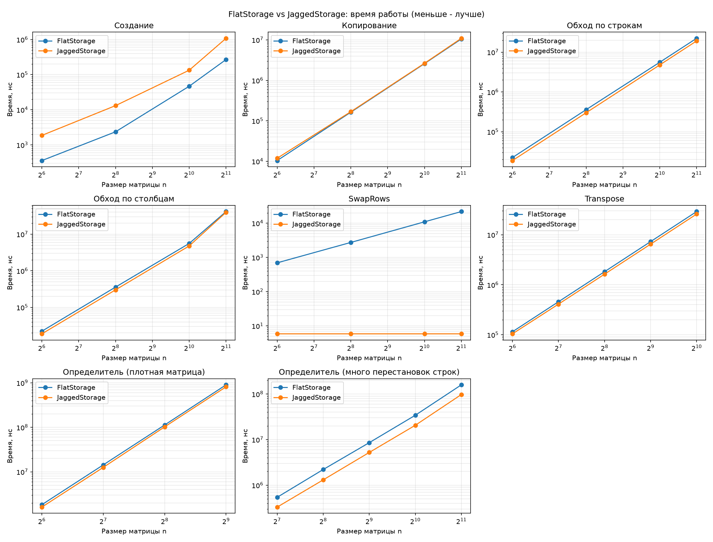
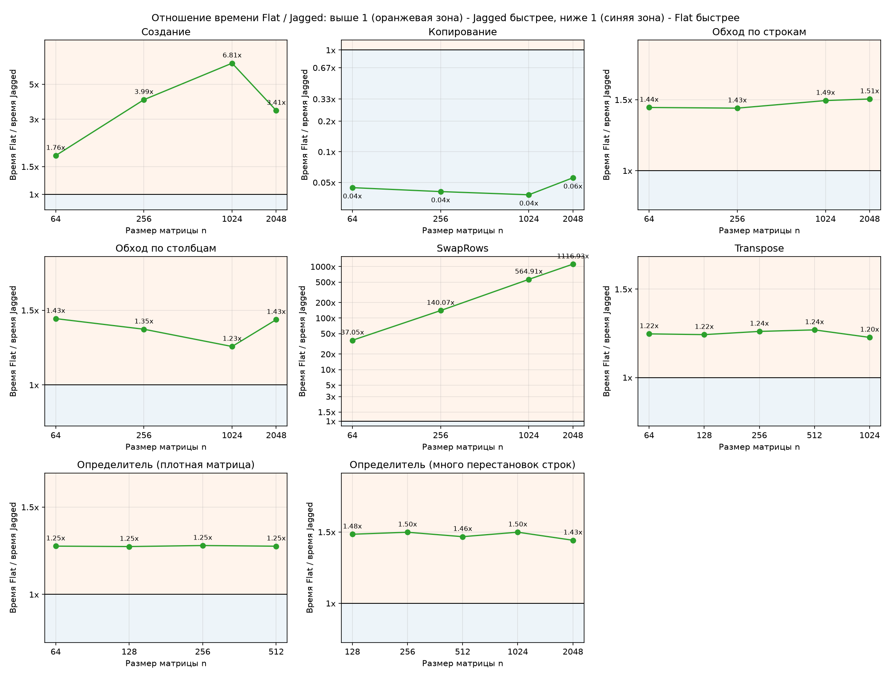
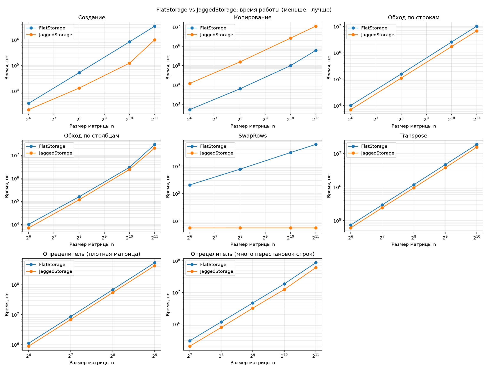
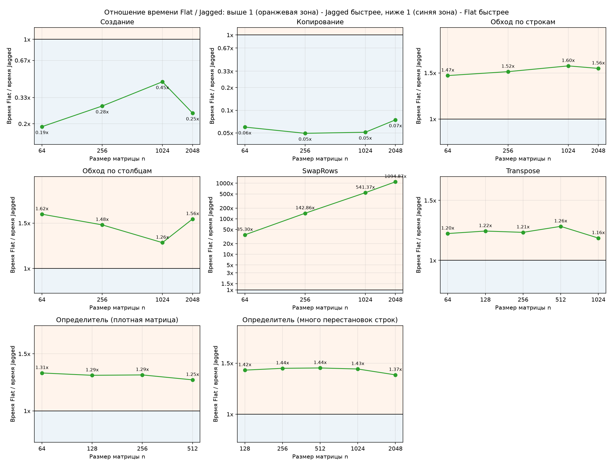
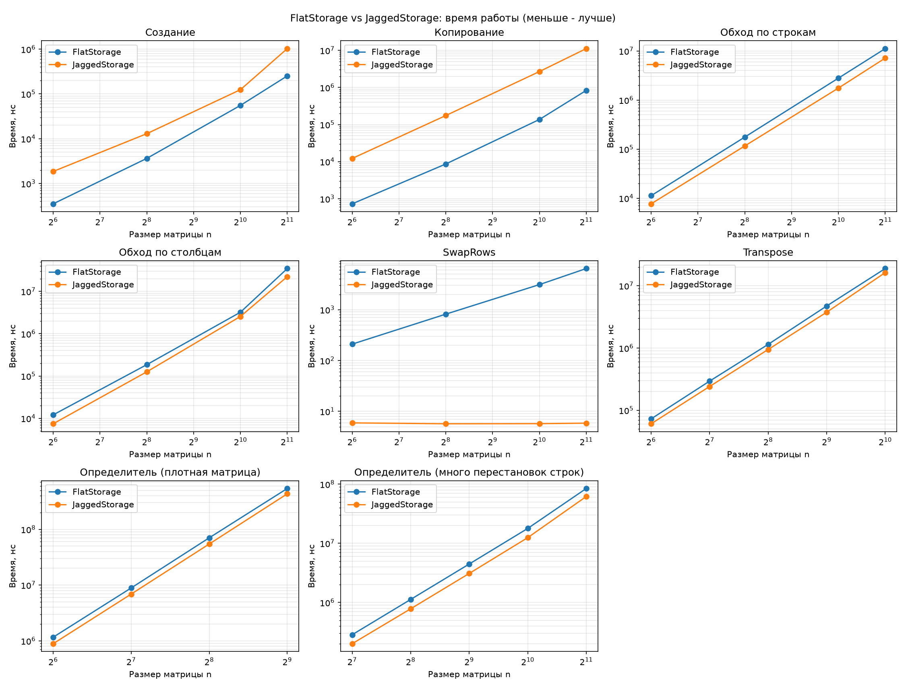
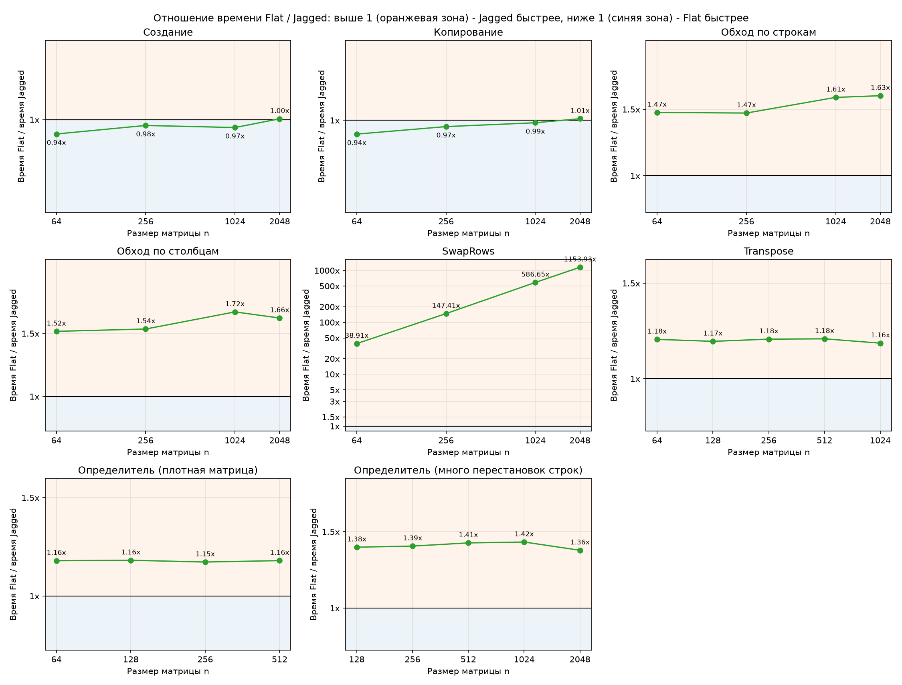
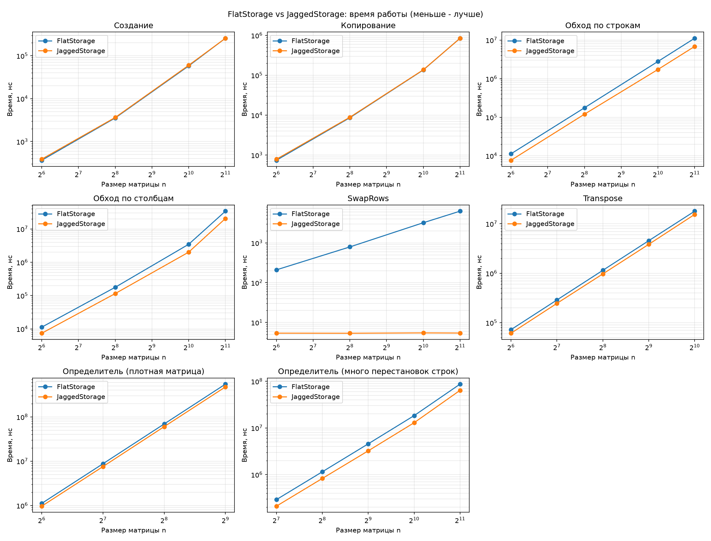

# Использование разных стратегий хранения матриц для подсчета определителя

Мной были реализованы 2 вида хранилищ:
- FlatStorage
- JaggedStorage

Для подсчета определителя я пользовалась следующими методами:
- Для вещественных - методом Гаусса-Жордана
- Для целочисленных - алгоритмом Барейса

## Оптимизации

### 1. Первоначальный вариант без copy/fill
2. Результаты сравнения эффективности хранилищ были таковы:

Видим, что jagged storage очень сильно отставал в копировании, а flat storage - в создании. 

### 2. Опитимизация flat с помощью copy/fill

- В первую очередь, в flat была аллокация пустого массива и потом, при необходимости, заполнение элементами. Я же подумала, что было бы лучше аллоцировать массив (без дефолтного значения), а затем заполнять его с помощью std::fill. 
- Заметила, что стало хуже. Скорее всего, это связано с тем, что ОС для больших аллокаций сразу может выделять зануленные страницы, во втором же варианте std::fill есть всегда. Поэтому эту "оптимизацию" убрала.
- В остальном же копирование для flat стало сильно быстрее 

## 3. Версия после отката изменения в аллокации

Теперь создание у flat стало сильно лучше, в остальных тестах увы после оптимизаций он показывать себя лучше не стал.

## 4. Оптимизации jagged с copy/fill

- Для честности эксперимента решила избавиться от ручных циклов и в jagged storage.
- Также аллокации заменила с size_ + 1 на 2, одна из которых на все хранилище единая. 

Видим, что разница в создании и копировании стала меньше, теперь они почти одинаковы по времени. В остальных же паттернах jagged везде стал чуточку лучше.
