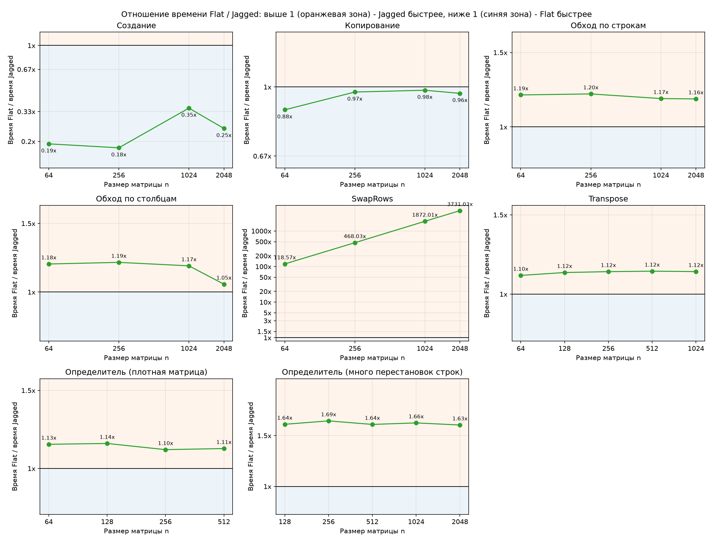

# Использование разных стратегий хранения матриц для подсчета определителя

Мной были реализованы 2 вида хранилищ:
- FlatStorage
- JaggedStorage

Для подсчета определителя я пользовалась следующими методами:
- Для вещественных - методом Гаусса-Жордана
- Для целочисленных - алгоритмом Барейса

На данный момент результаты сравнения эффективности хранилищ таковы:

За собой на данный момент оставляю такие комментарии по полученным результатам:
- Ясно, что FlatStorage не должен быть почти всегда хуже, значит, мне нужно попробовать его оптимизировать (попытаться избавиться от перестановок строк, если это возможно, как минимум)
- Также стоит проверить гипотезу с влиянием размера кеш-страниц на хранение данных
